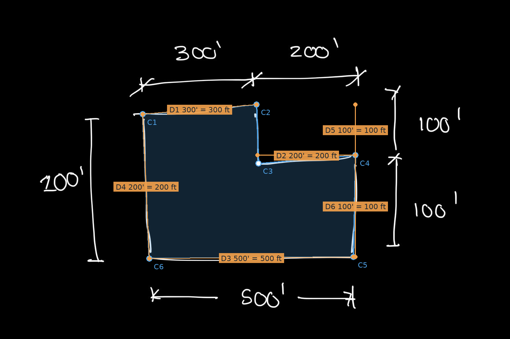

# Bones: sketch to structural scheme

Bones turns a photo of a hand-sketched floor plate into schematic structural framing options. It reads the sketch with Claude, rebuilds the plan to scale, pulls site hazards, and compares the best column grid and bay framing for **steel, concrete and mass timber**: depth, clear height, columns, cost, carbon, seismic weight and base shear. It is meant for the first conversation about a building, not for design.



## What this tool is, and what it is not

**It provides schematic-level framing from curated data. It does not create or run any analysis models.**

- No finite element or frame analysis model is built or run.
- Framing depths come from a curated bay study database (`data/bay_studies.sqlite`), produced ahead of time through engineering analysis, like published tables such as CRSI's. The app looks up a row the way an engineer reads a design table, rounding spans and loads **up**, never interpolating unconservatively.
- Column sizes (tributary loads, AISC capacity) and seismic base shear (ASCE 7-22 ELF) are hand-calculation-level formulas.
- Unit costs in `config/costs.json` are placeholders ([docs/COST_BASIS.md](docs/COST_BASIS.md)). Every assumption is in [docs/ASSUMPTIONS.md](docs/ASSUMPTIONS.md).

Results are a starting point for engineering judgment; a licensed engineer must design the structure.

## Setup

**1. Download.** `git clone https://github.com/xmontoya-pe/2026-NCSEA-Hackathon-MM.git`, or **Code > Download ZIP** on GitHub.

**2. Environment.** Either:
- **Dev container (recommended).** Needs Docker and VS Code with the Dev Containers extension. Open the folder and choose **Reopen in Container**. The container (`.devcontainer/`) is Python 3.14 on Debian, with Node.js, Claude Code and the Python extensions, running as `root`. VS Code forwards port 8765 automatically.
- **Your own machine.** Python 3.11 or newer (on Windows, tick "Add python.exe to PATH"). A virtual environment is optional.

Then install the libraries (the container doesn't do this for you):
```
pip install -r requirements.txt
pip install -r requirements-api.txt    # only for the Seismic ELF API
```

**3. Claude API key in `.env`.** **A key is required to read a hand sketch**: each new sketch is one call to Claude. Everything after the reading is plain Python and JavaScript. Get a key at https://console.anthropic.com (**Settings > API keys**), then create `.env` in the repo root:
```
ANTHROPIC_API_KEY=sk-ant-...
ASCE_HAZARD_TOKEN=...
```
`ASCE_HAZARD_TOKEN` is optional; without it, seismic values come from USGS and you type in wind and snow. `.env` is git-ignored. A key set as an environment variable takes priority, and the key is read when the server starts. Without a key, **Read sketch** is greyed out, but **Try the example sketch** and every later step still work.

## Run the web app

```
python -m bones_service.api
```

Open http://127.0.0.1:8765 (Ctrl+C stops it). Options: `--port 9000`, `--host 0.0.0.0` to share on your network, `--out <folder>` for sketch files (default `outputs/`). While developing, use `uvicorn bones_service.api:app --port 8765 --reload`; API docs are at `/docs`. If you edit `bones_service/static/src/`, rebuild the page with `python -m bones_service.build_ui`.

Use `bones_service.api`, not `bones_service.server`: that older server has no gravity optimizer.

### Steps

1. **Sketch.** Drop in a photo and press **Read sketch** (15 to 60 seconds), or **Try the example sketch**.
2. **Plan and 3D.** Check the plan against **Reading on photo**, fix stories or story height, then **Open in the drawing pad**.
3. **Drawing pad and loads.** Pull site hazards from the address, draw lines of resistance and load areas on each level, and pick an occupancy for every load area.
4. **Structural system.** A stand-in comparison of lateral systems (R, height limits, base shear).
5. **Analysis.** Set bay limits, ceiling height, plenum and ranking weights, then **Run the analysis**. You get the best grid per material, headline winners, a side-by-side table, results by level, runner-up grids and every warning. **Download results (JSON)** saves it all.

Your drawing is saved in the browser as you go. Details on each step and the endpoints: [BONES_SERVICE.md](BONES_SERVICE.md).

## Command line

```
python -m gravity run tests/fixtures/simple_rect.json -o out/   # out/output.json and out/warnings.log
python -m gravity report tests/fixtures/simple_rect.json        # best scheme and alternates per system
python -m gravity column tests/fixtures/simple_rect.json --column B-2   # every number for one column
uvicorn api:app --reload                                         # Seismic ELF API on :8000, POST /analyze
python -m unittest discover -s tests -v                          # tests (pytest also works)
```

Input format: [examples/README.md](examples/README.md). Spec: [GRAVITY_OPTIMIZER_SPEC.md](GRAVITY_OPTIMIZER_SPEC.md). From Python: `import gravity; gravity.run(input_dict)`.

## Sketch Reader on its own

`python app.py` opens a desktop window that reads one sketch and saves the plan as text, JSON, CSV, DXF, SVG and an overlay PNG. It does not read `.env`: set `ANTHROPIC_API_KEY` in the environment or paste the key into the window. Without a key:
```
python app.py examples/notched-sketch.png --reading examples/notched-sketch-reading.json
```

For good readings, write a dimension on every span with an overall for each chain, draw the slab edge heaviest, and write the story count and height on the sketch. Always check the overlay before using the numbers.

## Troubleshooting

| What you see | Fix |
|---|---|
| **Read sketch** is greyed out | No `ANTHROPIC_API_KEY`. Add it to `.env` and restart the server. |
| Occupancy says "unavailable", or **Run the analysis** fails | You started the old server. Run `python -m bones_service.api`. |
| A change to the page isn't showing | `python -m bones_service.build_ui`, then refresh. |
| "Address already in use" | Add `--port 9000`. |
| Many "Envelope: no DB row is designed for both..." warnings | Expected for office floors (docs/ASSUMPTIONS.md L-6). |
